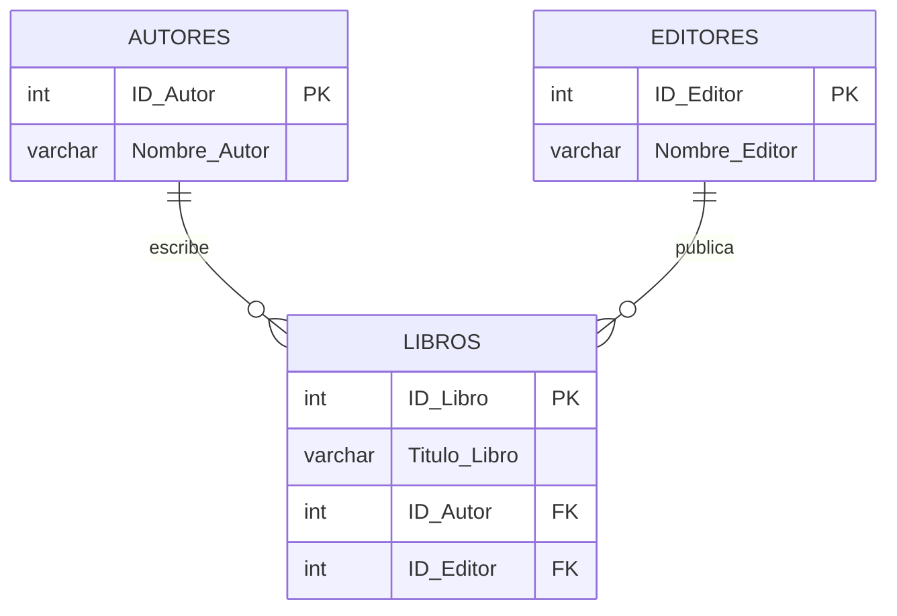

# 📚 Base de datos: Sistema de registro de libros de una biblioteca

Proyecto de diseño de base de datos relacional en **Tercera Forma Normal (3FN)** para registrar libros, autores y editores de una biblioteca.

## 🎯 Objetivo

Diseñar e implementar una base de datos que elimine la redundancia y las dependencias transitivas, organizando la información en tres tablas relacionadas: `Autores`, `Editores` y `Libros`.

## 🛠️ Tecnologías

- MySQL 8.x (compatible con MariaDB)
- MySQL Workbench
- Motor de almacenamiento InnoDB

## 📁 Estructura del repositorio

```
├── README.md              → Este documento
├── 01_esquema.sql         → Creación de la base de datos y las tablas
├── 02_datos_ejemplo.sql   → Datos de prueba
├── 03_consultas.sql       → Consultas de verificación y pruebas de integridad
├── diagrama_ER.png        → Diagrama entidad-relación exportado de Workbench
├── biblioteca.mwb         → Modelo de MySQL Workbench
└── capturas/              → Evidencias de ejecución
```

## 🗂️ Diagrama Entidad-Relación


Versión en Mermaid:



**Relaciones:**
- Un autor puede tener muchos libros; cada libro tiene un solo autor (1 : N).
- Un editor puede publicar muchos libros; cada libro tiene un solo editor (1 : N).

## 📖 Diccionario de datos

### Autores
| Campo | Tipo | Restricciones | Descripción |
|---|---|---|---|
| `ID_Autor` | INT | PK, AUTO_INCREMENT | Identificador único del autor |
| `Nombre_Autor` | VARCHAR(100) | NOT NULL, UNIQUE | Nombre completo del autor |

### Editores
| Campo | Tipo | Restricciones | Descripción |
|---|---|---|---|
| `ID_Editor` | INT | PK, AUTO_INCREMENT | Identificador único del editor |
| `Nombre_Editor` | VARCHAR(100) | NOT NULL, UNIQUE | Nombre de la editorial |

### Libros
| Campo | Tipo | Restricciones | Descripción |
|---|---|---|---|
| `ID_Libro` | INT | PK, AUTO_INCREMENT | Identificador único del libro |
| `Titulo_Libro` | VARCHAR(200) | NOT NULL | Título del libro |
| `ID_Autor` | INT | FK → Autores, NOT NULL | Autor del libro |
| `ID_Editor` | INT | FK → Editores, NOT NULL | Editorial del libro |

Las claves foráneas usan `ON UPDATE CASCADE` y `ON DELETE RESTRICT`: no se puede eliminar un autor o editor que tenga libros asociados.

## 🧮 Normalización

### Punto de partida (sin normalizar)

| ID_Libro | Titulo_Libro | Nombre_Autor | Nombre_Editor |
|---|---|---|---|
| 1 | Cien años de soledad | Gabriel García Márquez | Editorial Sudamericana |
| 2 | El amor en los tiempos del cólera | Gabriel García Márquez | Penguin Random House |
| 3 | Rayuela | Julio Cortázar | Editorial Sudamericana |

Problemas: datos repetidos, cambios que deben hacerse en muchas filas y pérdida de información al borrar registros.

### Aplicación de las formas normales

- **1FN:** todos los campos son atómicos y cada fila tiene una clave primaria.
- **2FN:** todas las tablas tienen clave primaria simple, por lo que no existen dependencias parciales.
- **3FN:** se eliminan las dependencias transitivas:
  - `ID_Libro → ID_Autor → Nombre_Autor`
  - `ID_Libro → ID_Editor → Nombre_Editor`

  Los nombres se mueven a sus propias tablas y `Libros` solo conserva las claves foráneas.

## 🚀 Cómo ejecutar el proyecto

### Con MySQL Workbench
1. Abre una conexión a tu servidor MySQL.
2. Abre `01_esquema.sql` y ejecútalo completo (icono del rayo o `Ctrl + Shift + Enter`).
3. Abre `02_datos_ejemplo.sql` y ejecútalo.
4. Abre `03_consultas.sql` y ejecuta las consultas una por una (`Ctrl + Enter`).

### Con la línea de comandos
```bash
mysql -u root -p < 01_esquema.sql
mysql -u root -p < 02_datos_ejemplo.sql
mysql -u root -p < 03_consultas.sql
```

> ⚠️ El script `01_esquema.sql` elimina la base de datos `biblioteca` si ya existe y la vuelve a crear.

## 🔍 Consultas incluidas

| # | Descripción |
|---|---|
| 1 | Catálogo completo de libros con su autor y editor (JOIN) |
| 2 | Libros de un autor específico |
| 3 | Cantidad de libros por editor |
| 4 | Cantidad de libros por autor |
| 5 | Actualización de un editor en un solo lugar |
| a, b | Pruebas de integridad referencial (deben generar error) |

## 🔮 Posibles mejoras

- Tabla intermedia `Libro_Autor` para libros con varios autores (relación N : M).
- Campos adicionales: ISBN, año de publicación, género, número de ejemplares.
- Tablas de socios y préstamos para gestionar la circulación de libros.

## 👤 Autor

**Tu nombre aquí**
Programa / Curso: _nombre del curso_
Fecha: _dd/mm/aaaa_
